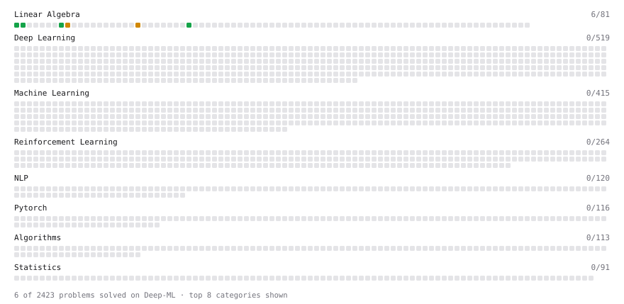

# Deep-ML

My machine learning practice from [Deep-ML](https://www.deep-ml.com). Every solution here was written by hand.

**10** solved · 4 problems · 0 labs · 6 math

[**Browse the interactive portfolio**](https://elvern18.github.io/deep-ml/) to replay this filling in over time.

## Problems

| | Difficulty | Solved | |
| --- | --- | --- | --- |
| [Dot Product Calculator](https://www.deep-ml.com/problems/83) | easy | 2026-10-29 | [solution](problems/0083-dot-product-calculator) |
| [Matrix-Vector Dot Product](https://www.deep-ml.com/problems/1) | easy | 2026-10-29 | [solution](problems/0001-matrix-vector-dot-product) |
| [Transpose of a Matrix](https://www.deep-ml.com/problems/2) | easy | 2026-10-29 | [solution](problems/0002-transpose-of-a-matrix) |
| [Matrix times Matrix ](https://www.deep-ml.com/problems/9) | medium | 2026-10-29 | [solution](problems/0009-matrix-times-matrix) |

## Math

| | Difficulty | Solved | |
| --- | --- | --- | --- |
| [Bytes in the KV Cache (MHA, GQA, MQA, MLA)](https://www.deep-ml.com/math-problems/62) | easy | 2026-11-23 | [solution](math/0062-bytes-in-the-kv-cache-mha-gqa-mqa-mla) |
| [Matrix Basics](https://www.deep-ml.com/math-problems/9) | easy | 2026-10-29 | [solution](math/0009-matrix-basics) |
| [Vector Operations](https://www.deep-ml.com/math-problems/7) | easy | 2026-10-29 | [solution](math/0007-vector-operations) |
| [Arithmetic Intensity of Matmul vs Decode Attention](https://www.deep-ml.com/math-problems/63) | medium | 2026-11-23 | [solution](math/0063-arithmetic-intensity-of-matmul-vs-decode-attention) |
| [Matrix Multiplication](https://www.deep-ml.com/math-problems/10) | medium | 2026-10-29 | [solution](math/0010-matrix-multiplication) |
| [Roofline: Time is the Max of Bytes/BW and FLOPs/Peak](https://www.deep-ml.com/math-problems/64) | medium | 2026-11-23 | [solution](math/0064-roofline-time-is-the-max-of-bytes-bw-and-flops-peak) |

---

_This file is regenerated by Deep-ML on every push._
